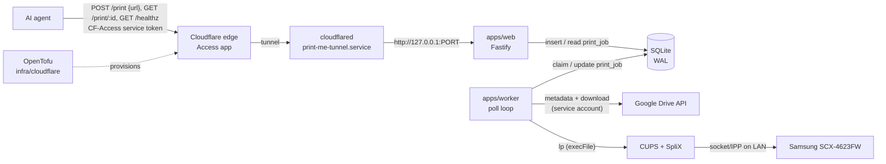
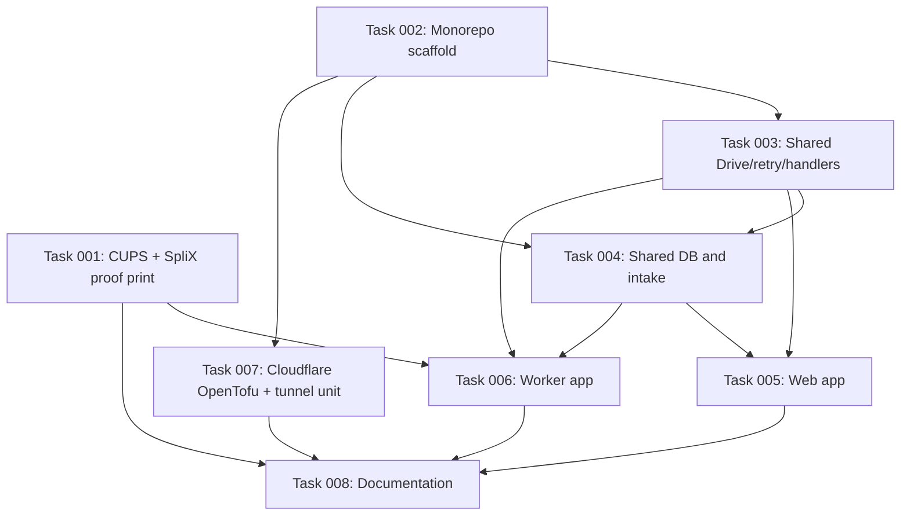

# Plan: Google Drive PDF Print Webhook

## Original Work Order

> A simple Typescript Node.js server which hosts a webhook that allows an ai agent to post a document that is hosted on my Google Drive to print. The agent will create a PDF and save it to my Google Drive, then post a webhook to this server to request a print with a link to the Google Drive document to print. We only need to support PDF at first, although if separate support is necessary for different document types, plan for that with a modular architecture per document type. My printer is hosted on my local network, the same local network where this server will run. Its connection parameters should be parametarized using environment variables, documented in a `.env.example`, with how to set that up documented in the repo. The repo should not carry any personal information, credentials or connection information, it is a public repo. A cloudflare tunnel should be configured to make the server available via the public internet. Use opentofu to configure the Cloudflare pieces. When the server revices a webhook, it should queue the request in a sqlite database. Use TypeORM to manage the database. There should be a worker that runs to periodically read the queue, fetch the document in an authenticated way from my Google Drive folder, and then send it to the printer. If the document read or print fails after more than 5 tries, give up. The print is a Samsung Monochrome All-In-One Wireless Laser Printer with Fax (SCX-4623FW). Work out the most straightforward, popular library supported way to send a print job to it from the worker. If the server and worker should be separate, strucutre them as apps/worker and apps/web in this repo as a pnpm monorepo. User prittier for code formatting. Ask me about any ambiguities in the plan as indicated.

## Plan Clarifications

| Question | Answer |
| --- | --- |
| What host and runtime will web, worker and cloudflared run on? | The same Raspberry Pi (Linux) that runs the user's `m4olivei/screen-time` app, using **systemd with no Docker**. Mirror screen-time's setup conventions and requirements where relevant. |
| How does the worker send the PDF to the printer? | **CUPS on the Pi**, which converts the PDF with the printer driver. Originally to be submitted through the `unix-print` npm package; **superseded** by calling `lp` directly (see the refinement rows below). |
| How do webhook callers authenticate? | A **Cloudflare Access service token** checked at the edge (`CF-Access-Client-Id` / `CF-Access-Client-Secret` headers). The app has no auth of its own and binds to `127.0.0.1`. |
| How does the worker authenticate to Google Drive? | With a **Google Cloud service account**. The print folder is shared with the service account's email as Viewer, and its JSON key file sits on the Pi at a path set in env. |
| What is the webhook payload? | **Only the Drive URL**: `POST /print` with `{ "url": "<drive link>" }`. The document type comes from the Drive file's mimeType at processing time. |
| Does the agent need job status? | **Yes**: `POST /print` returns `202 { id }` and `GET /print/:id` returns the job's state, attempt count, last error and CUPS job ID. |
| How do retries and polling work? | **At most 5 attempts in total** (fetch + print together count as one attempt), with retries after 1, 2, 4 and 8 minutes. The job is then marked `failed`. The worker polls every 10 s (`POLL_INTERVAL_MS`), one job at a time. An unsupported document type fails immediately with no retries. |
| When does a job count as printed? | When **CUPS accepts it** (`lp` returns a CUPS job ID, which is stored). Delivery to the physical printer is left to CUPS. |
| Which HTTP framework? | **Fastify**. |
| Backwards compatibility? | **Not required**: this is a greenfield repo. |
| How should `POST /print` handle a retried request? *(source: webhook agent review → user)* | **Dedupe on `driveFileId`.** If a job for the same Drive file is still `queued` or `processing`, return `200 { id }` for that job instead of creating a new one. Once it is `printed` or `failed`, posting the same file creates a new job, so reprinting stays possible. No `Idempotency-Key` header. |
| How should print volume be capped against a leaked token? *(source: webhook agent review → user)* | **An app-level hourly cap.** `POST /print` returns `429` once the jobs created in the last hour reach `MAX_JOBS_PER_HOUR` (web env, default 20). A deduplicated request does not count. No Cloudflare rate-limit rule. |
| Should the backoff be shortened, since a failing job takes ~15 min to read `failed`? *(source: webhook agent review → user)* | **Keep 1/2/4/8 minutes.** The API reference documents the ~15-minute worst case and that `attempts`/`lastError` are visible after the first failure. |
| How should the worker submit to CUPS, given that `unix-print`'s last release was November 2023? *(source: webhook agent review → user)* | **Call `lp` directly** with Node's `execFile` (an argument array, no shell) and parse the CUPS job ID from its output. `unix-print` is dropped. |
| Which optional extras go in? *(source: webhook agent review → user)* | **Both:** `GET /healthz` (behind Access) and a **Drive size cap** (`MAX_FILE_BYTES`, worker env, default 50 MB, checked from metadata before download; over the cap is a permanent failure). |
| How long should the Access service token last? *(source: webhook agent review → user)* | **Cloudflare's default of 1 year (8760h).** OpenTofu outputs its expiry, and the README documents rotation and re-vaulting. |
| How is the partial unique index created, given that TypeORM `synchronize` has historically been unreliable with partial (`WHERE`) indexes? *(source: webhook agent review → user)* | **Raw SQL at startup plus an assertion.** Tables stay on `synchronize: true`. After the data source initialises, the shared package runs `CREATE UNIQUE INDEX IF NOT EXISTS` on `driveFileId` `WHERE state IN ('queued','processing')`, then checks `sqlite_master` and refuses to start if the index is missing. On a unique-constraint error, job intake returns the existing active job (`200 { id }`). |
| Should the 429 tell the caller when to retry? *(source: webhook agent review → user)* | **Yes:** the seconds until the oldest job in the 1-hour window ages out (rounded up, minimum 1), sent as both a `Retry-After` header and `retryAfterSeconds` in the JSON body. |

## Executive Summary

This plan builds a small self-hosted print service on a Raspberry Pi on the local network. An AI agent saves a PDF to a shared Google Drive folder and POSTs its link to a public webhook. The webhook records a job in SQLite and returns right away. A retried request for a file that is still waiting returns the existing job instead of queueing a second print, and an hourly cap limits how much a leaked credential could print. A separate worker process polls the queue, downloads the file from Drive as a service account, and submits it to a local CUPS queue for the Samsung SCX-4623FW. Cloudflare Tunnel publishes the webhook without opening any inbound port. Cloudflare Access, with a service token, is the only authentication layer. All Cloudflare resources are declared in OpenTofu.

The architecture copies the proven `screen-time` project on the same Pi: a pnpm workspace with `apps/web`, `apps/worker` and `packages/shared`; TypeORM over `better-sqlite3` as the only shared state between the processes; systemd units under a dedicated service user in `/opt`; `cloudflared` from Cloudflare's apt repo running with a token file; and OpenTofu (Cloudflare provider v5) with local, git-ignored state. Reusing those patterns keeps operations familiar and avoids new infrastructure decisions.

Printing goes through CUPS rather than straight to the printer. The SCX-4623FW is a low-cost Samsung laser that most likely speaks only Samsung's proprietary SPL language, so raw PDF sent to port 9100 or IPP would not print. CUPS with the open-source SpliX driver (available for ARM through Debian's `printer-driver-splix`) converts PDF to SPL. The worker then only needs to run `lp`, which it calls directly rather than through a wrapper library. A spike early in execution confirms this end to end before the rest is built on it.

## Context

### Current State vs Target State

| Current State | Target State | Why? |
| --- | --- | --- |
| The repo holds only Strikethroo tooling; no application code | A pnpm workspace with `apps/web`, `apps/worker`, `packages/shared`, formatted with Prettier | The work order asks for a TypeScript monorepo with separate server and worker |
| No way for an agent to request a print | A public `POST /print` webhook that accepts a Google Drive link and queues a job | The agent's workflow ends with a print request |
| No record of print requests | A SQLite `print_job` table managed by TypeORM, shared by web and worker | Requests must be queued durably and processed asynchronously |
| The printer is reachable only on the LAN with no automation | A CUPS queue on the Pi (SpliX driver) fed by a worker that calls `lp` directly | The worker needs a reliable, library-supported way to print to an SPL printer |
| The Pi has no access to Drive files | The worker downloads files as a Google service account with read-only access to a shared folder | Documents must be fetched with authentication from the user's Drive |
| The webhook is not reachable from the internet | A Cloudflare Tunnel with a proxied hostname, protected by an Access app that admits only a service token, all declared in OpenTofu | The agent runs outside the LAN, and the endpoint must not be open to anyone |
| No setup documentation | README and AGENTS.md covering Google, CUPS, Cloudflare, systemd and env setup; `.env.example` and `terraform.tfvars.example` files | The repo is public, so setup must be documented without committing personal data |

### Background

- **Reference implementation.** `github.com/m4olivei/screen-time` runs on the same Pi and sets the conventions to copy. Its parts:
  - Root `package.json` with `build`, `check`, `format` and `format:check` scripts, and `packageManager` pinned to pnpm 11.
  - `pnpm-workspace.yaml` covering `packages/*` and `apps/*`, with `allowBuilds` set for `better-sqlite3` and `esbuild`.
  - `tsconfig.base.json`.
  - `.prettierrc` with tabs, single quotes, no trailing commas and `printWidth` 100.
  - A per-app `.env` with a committed `.env.example`.
  - TypeORM entities in `packages/shared/src/db/entities/` with `synchronize: true` and WAL mode.
  - vitest unit tests alongside the pure logic in the shared package.
  - The worker as a long-running interval loop under systemd (dev and start via `tsx`, built to `dist/`).
  - Install at `/opt/<app>` owned by a loginless system user.
  - A hardened `<app>-tunnel.service` running `cloudflared --token-file /etc/cloudflared/token`.
  - `infra/cloudflare/` with `versions.tf`, `variables.tf`, `tunnel.tf`, `access.tf`, `outputs.tf`, `terraform.tfvars.example`, and a committed `.terraform.lock.hcl`.
  - A `.gitignore` that excludes `.env*` (except examples), tfstate and tfvars.
- **Printer language.** Inexpensive Samsung lasers of this generation usually support only SPL, not PostScript or PCL. SpliX is the open-source CUPS driver for SPL printers, and Samsung's proprietary Unified Linux Driver is effectively x86-only.
- **Pi state (verified).** arm64 Debian 13 with Node 24 LTS, already serving screen-time. CUPS, `cups-filters` and `printer-driver-splix` are installed with `--no-install-recommends`. `cups-browsed` is **not** installed, and CUPS listens on loopback only. SpliX ships a **model-specific PPD**, `drv:///splix-samsung.drv/scx4623fw.ppd` ("Samsung SCX-4623fw"). What is still unproven is a physical print through it.
- **pnpm.** Pin `packageManager` to the same pnpm 11.20.0 as screen-time, so both projects on the Pi use one version. Outside a pinned project, corepack's default is 12.x.
- **Shared Cloudflare account.** The domain and Zero Trust organisation already exist for screen-time. This project creates its **own** tunnel, DNS record and Access application in its own OpenTofu state, so the two apps can be deployed and torn down independently. Unlike screen-time, no Google identity provider is involved: only a service token gets through.
- **Public repo.** No hostnames, IP addresses, email addresses, account or zone IDs, folder IDs, keys or tokens may be committed. Examples use placeholders such as `print.example.com` and `<printer-ip>`.

## Architectural Approach

The system is three processes on one Pi, joined only by a SQLite file and the local CUPS daemon. Cloudflare is the only way in from the internet.

### Monorepo Scaffold and Tooling

**Objective**: Set up the workspace skeleton and conventions every other component builds on.

- A pnpm workspace with `apps/web`, `apps/worker` and `packages/shared` (package name scoped like screen-time, e.g. `@print-me/shared`). The workspace config and root scripts follow the screen-time conventions listed under Background.
- TypeScript throughout, with a shared `tsconfig.base.json`. Prettier is the only formatter (`.prettierrc` matching screen-time's style, minus the Svelte and Tailwind plugins this project doesn't need) plus a `.prettierignore`.
- A root `.gitignore` adapted from screen-time: `.env` files except examples, OpenTofu state/tfvars/`.terraform/`, `node_modules`, `dist`, the `/data/` directory holding the SQLite file, and service-user dotfiles in the checkout root. The Google service-account key file also gets an ignore pattern for the case where it is placed inside the checkout, although the documented location is outside it.

### Shared Package: Database, Job Intake, Drive, Document Handlers, Retry Logic

**Objective**: Keep all shared state, external clients and pure logic in one place so web and worker cannot drift apart.

- **Data source**: a TypeORM `DataSource` on `better-sqlite3` with `synchronize: true` for tables (greenfield, as in screen-time). WAL journal mode and a busy timeout let the web process and worker write at the same time. The database location comes from a `DB_PATH` env var that both apps set to the same file. A shared initialisation step, used by both apps, runs after the data source initialises:
  1. It creates the partial unique index (below) with raw SQL (`CREATE UNIQUE INDEX IF NOT EXISTS`), because TypeORM `synchronize` has historically been unreliable with partial indexes.
  2. It checks `sqlite_master` for that index and **refuses to start** if it is missing, so the dedupe backstop can never be silently absent. See Plan Clarifications (index creation).
- **`PrintJob` entity** (`print_job` table) with these fields:
  - Generated id.
  - The submitted Drive URL and the extracted `driveFileId`.
  - `state`: `queued`, `processing`, `printed` or `failed`.
  - `attempts`, a counter from 0 to 5.
  - `nextAttemptAt`.
  - `lastError`, a short message.
  - The `mimeType` resolved from Drive.
  - The `cupsJobId` returned by `lp`.
  - `createdAt` and `updatedAt`.

  A **partial unique index** on `driveFileId` covering only rows in `queued` or `processing` makes "one active job per Drive file" a database guarantee rather than just an application check. It is created by the initialisation step above, **not** declared through TypeORM.
- **Job intake** (one function, used by the web app, tested against a temporary SQLite file): in a single transaction it
  1. returns the existing job if one for the same `driveFileId` is `queued` or `processing` (the deduplicated case);
  2. otherwise counts jobs created in the last hour and refuses if the count has reached `MAX_JOBS_PER_HOUR`;
  3. otherwise inserts a new `queued` job with `nextAttemptAt = now`.

  If the insert fails with a unique-constraint error (`SQLITE_CONSTRAINT_UNIQUE`, meaning a concurrent request won the race), intake re-reads the active job for that `driveFileId` and returns it as the deduplicated case. Any other error propagates. When it refuses for the cap, intake also returns **`retryAfterSeconds`**: the seconds until the oldest job in the 1-hour window ages out, rounded up, minimum 1.

  Dedupe is checked before the cap, so a retried request never counts toward the cap. See Plan Clarifications (idempotency, abuse cap, index creation, 429 retry hint).
- **Drive URL parsing** (pure, unit-tested): extracts the file ID from the common Drive link shapes (`/file/d/<id>/…`, `open?id=<id>`, `uc?id=<id>`) and rejects anything else.
- **Retry policy** (pure, unit-tested): one place owns `MAX_ATTEMPTS = 5` and the backoff schedule (1, 2, 4, 8 minutes). Given the attempt count it returns either the next attempt time or "give up".
- **Drive client**: uses Google's official Node client authenticated as the service account (key file path from env, read-only Drive scope). Exposes "get metadata (name, mimeType, size)" and "download content to a local temp file".
- **Document-type handler registry**: a small interface keyed by mimeType. A handler receives the downloaded file and returns what to pass to the printer (file path plus any `lp` options). The only handler registered is `application/pdf`, which passes the file through unchanged. A mimeType with no handler is an **unsupported document type**, a permanent error that skips retries. Adding a new type later means writing one handler and registering it, with no changes to the worker loop.

### Web App (apps/web)

**Objective**: Accept print requests and report job status, and do nothing else.

- A Fastify server that listens only on `127.0.0.1` (port from env, default similar to screen-time's convention but distinct from its 3000), because the tunnel connector is its only client and any LAN-facing port would bypass Access.
- `POST /print`:
  1. Validates the JSON body with a Fastify schema: a single required `url` string.
  2. Parses the Drive file ID and returns 400 if the link is not a recognised Drive link.
  3. Runs the shared job-intake function and maps its result:
     - an existing active job for the same file → `200 { id }`;
     - the hourly cap reached → `429` with a `Retry-After` header and a JSON body carrying a short error message and `retryAfterSeconds` (the same value);
     - a new job → `202 { id }`.
- `GET /print/:id` returns the job's `id`, `state`, `attempts`, `lastError`, `cupsJobId`, `createdAt` and `updatedAt`, or 404.
- `GET /healthz` runs a trivial SQLite query and returns `200 { ok: true }`. Like every route, it sits behind Access, so it lets the agent tell an Access rejection (403), a down app (502) and a down tunnel (1033) apart.
- Env: `DB_PATH`, the listen port, and `MAX_JOBS_PER_HOUR` (default 20).
- The web app does **not** call Google Drive or CUPS. It only reads and writes SQLite.
- Logging uses Fastify's built-in pino logger to stdout, which journald collects.
- A systemd unit, `print-me-web.service`, is modelled on screen-time's web unit.

### Worker (apps/worker)

**Objective**: Process queued jobs reliably: fetch from Drive, print through CUPS, and give up after 5 failed attempts.

- A long-running Node process that ticks every `POLL_INTERVAL_MS` (default 10000). Each tick handles at most one due job: the oldest job in `queued` whose `nextAttemptAt` has passed.
- **Claiming**: the job moves to `processing` before any work, so a slow job is never picked up twice. At startup, any job left in `processing` by a crash goes back to `queued`, because this is the only worker.
- **Steps for one attempt**:
  1. Fetch Drive metadata (name, mimeType, size).
  2. Reject a file larger than `MAX_FILE_BYTES` (default 50 MB) before downloading.
  3. Look up the handler by mimeType.
  4. Download the file to a private temp directory.
  5. Run the handler.
  6. Submit with `lp` to the CUPS queue named by `CUPS_PRINTER_NAME`, using Node's `execFile` with an argument array (no shell). A small helper owns this call and parses the CUPS job ID from `lp`'s `request id is <queue>-<n>` line; unparseable output counts as a failed attempt. The helper is unit-tested with a stubbed exec.
  7. Store the returned CUPS job ID and mark the job `printed`.
  8. Always delete the temp file afterwards.
- **Failure handling**:
  - Any thrown error increments `attempts` and records a truncated `lastError`. Using the shared retry policy, the job then either returns to `queued` with a backoff `nextAttemptAt` or becomes `failed` once 5 attempts have been used.
  - **Permanent failures** skip retries and go straight to `failed`: an unsupported mimeType, and a file over `MAX_FILE_BYTES`.
  - A failure in one job never stops the loop.
- The worker is the only process that calls Google Drive and CUPS.
- A systemd unit, `print-me-worker.service`, follows screen-time's worker unit (`Restart=always`). It runs as the service user, which must be able to submit to the CUPS queue.

### Printer Integration (CUPS + SpliX on the Pi)

**Objective**: Make the SCX-4623FW a working CUPS queue that the worker can target by name, configured entirely from env values.

- **Spike first**: CUPS and `printer-driver-splix` are already installed on the Pi (see Background). Create the queue with `lpadmin`, using the model-specific PPD `drv:///splix-samsung.drv/scx4623fw.ppd` and the printer's network device URI (e.g. `socket://<printer-ip>:9100`). Print a sample PDF with `lp`. The working URI scheme is then written into the docs. If SpliX cannot drive the printer, stop and bring the alternatives back to the user before building on this.
- The README documents the package install as it was actually done: `apt-get install --no-install-recommends cups cups-client cups-filters printer-driver-splix`. `--no-install-recommends` keeps out `cups-browsed`, which isn't needed and had a serious vulnerability in 2024. CUPS stays loopback-only.
- The printer connection lives in `apps/worker/.env`:
  - `PRINTER_DEVICE_URI`: the printer's network address. Used only by the documented `lpadmin` setup step.
  - `CUPS_PRINTER_NAME`: the queue name the worker prints to.
- The README documents a reproducible setup: install packages, reserve a DHCP address for the printer, create the queue with `lpadmin` from those env values, and run a test print with `lp`.

### Cloudflare Tunnel and Access (infra/cloudflare, OpenTofu)

**Objective**: Publish the webhook at a public hostname with edge-only authentication, fully declared in code.

- OpenTofu with the `cloudflare/cloudflare` **v5** provider, laid out like screen-time (`versions.tf`, `variables.tf`, `tunnel.tf`, `access.tf`, `outputs.tf`, `terraform.tfvars.example`, committed `.terraform.lock.hcl`). State is local, plaintext and git-ignored.
- The API token comes from `CLOUDFLARE_API_TOKEN` in the shell and is never written to a file.
- **Resources**:
  - A remotely managed Cloudflare Tunnel whose ingress maps the hostname to `http://127.0.0.1:<web port>`, plus a catch-all 404.
  - A proxied CNAME for a single-label hostname under the zone (Universal SSL caveat, as in screen-time).
  - An Access self-hosted application for the hostname.
  - An Access **service token** with Cloudflare's default duration of one year (8760h). See Plan Clarifications (token life).
  - An Access policy that admits **only** that token (non-identity/service-auth decision). No identity provider and no email allow-list.
- **Variables**: account ID, zone ID, hostname, and the web port.
- **Outputs**: the tunnel token (pasted onto the Pi) and the service token's client ID and client secret (handed to the agent through a vault link, never in chat), all marked sensitive; plus the service token's expiry date (not sensitive), so a rotation reminder can be set.
- A systemd unit, `print-me-tunnel.service`, copies screen-time's hardened tunnel unit with a different metrics port, so it can run next to screen-time's connector on the same Pi. Because both connectors read a token file, this tunnel's token goes in its own file under `/etc/cloudflared/`, separate from screen-time's.

## Risk Considerations and Mitigation Strategies

Technical Risks

- **SpliX may not actually print correctly on the SCX-4623FW**: a model-specific PPD exists (`scx4623fw.ppd`, confirmed on the Pi), but no physical print has been made yet, and SpliX is no longer actively developed.
    - **Mitigation**: the CUPS/SpliX proof print is the first execution step and gates everything else. If it fails, execution stops and the user is consulted. Options would include Samsung's driver on another host, or checking whether the printer accepts PCL/PostScript.
- **Concurrent SQLite writers** (web inserts while the worker updates) could cause `SQLITE_BUSY`.
    - **Mitigation**: WAL mode plus a busy timeout on the shared data source, the same as screen-time. Write volume is tiny.
- **Duplicate prints**: if `lp` succeeds but the following database update fails, the job could be retried and printed twice.
    - **Mitigation**: the job is updated straight after `lp` returns. The window is accepted as negligible for this workload and recorded in AGENTS.md.
- **Retried webhook calls**: a client timeout after the row is inserted, followed by a retry, could queue the same document twice.
    - **Mitigation**: dedupe on `driveFileId` while a job is active, guaranteed by the partial unique index (see Job intake).
- **The partial index silently missing**: TypeORM `synchronize` has historically been unreliable with partial (`WHERE`) indexes. Without the index, concurrent duplicate requests could both insert.
    - **Mitigation**: the index is created with raw SQL at startup, startup fails if `sqlite_master` doesn't list it, and tests prove that a duplicate active insert hits the constraint and that intake recovers with the existing id.
- **`lp` output format**: the CUPS job ID is parsed from `lp`'s text output, which a CUPS upgrade could in principle change.
    - **Mitigation**: the parser is unit-tested on the known format, and unparseable output fails the attempt loudly with the raw output in `lastError` rather than marking the job printed.
- **Drive file not yet visible**: the agent may POST before the upload has finished or before sharing has propagated.
    - **Mitigation**: the 1/2/4/8-minute backoff over 5 attempts covers this naturally.

Security Risks

- **Leaking secrets or personal data into a public repo** (service-account key, tunnel token, service-token secret, hostname, IPs, IDs).
    - **Mitigation**: only `.env.example` and `terraform.tfvars.example` with placeholders are committed. `.gitignore` covers `.env*`, tfvars, tfstate and key files. Validation includes a scan of the tracked files.
- **Bypassing Access**: a LAN-reachable web port would skip edge authentication.
    - **Mitigation**: the web app binds to `127.0.0.1` only. This is recorded as a binding invariant in AGENTS.md.
- **Leaked service token**: anyone holding it could submit prints.
    - **Mitigation**: the hourly job cap (`MAX_JOBS_PER_HOUR`) bounds the damage, and the size cap bounds each job. Rotation (below) revokes the token.
- **Service token expiry**: Access service tokens expire (one year by default), after which the agent's requests start failing.
    - **Mitigation**: OpenTofu outputs the expiry date. The README documents rotation: replace the token with `tofu apply -replace`, re-vault the new secret, and update the agent.
- **Over-broad Drive access**.
    - **Mitigation**: the service account uses the read-only scope and can only see files explicitly shared with it, meaning the one print folder.

Implementation Risks

- **CUPS permissions for the service user**: submitting jobs from a loginless system user can be blocked by CUPS policy.
    - **Mitigation**: verified as part of the deployment validation (submit `lp` as the service user). The README documents any group membership or setting that turns out to be needed.
- **Two cloudflared connectors on one Pi** could clash on the metrics port or token file path.
    - **Mitigation**: a distinct metrics port and a distinct token file for this tunnel.

## Success Criteria

### Primary Success Criteria

1. `POST /print` with a valid Drive link returns `202 { id }` and creates a `queued` row. An invalid link returns 400. `GET /print/:id` reports the job's current state, and `GET /healthz` returns 200.
2. Posting the same Drive link again while its job is `queued` or `processing` returns `200` with the same `id` and creates no row. Once the job is `printed` or `failed`, posting it again creates a new job.
3. Once `MAX_JOBS_PER_HOUR` jobs have been created in the last hour, `POST /print` returns 429 with a `Retry-After` header and a matching `retryAfterSeconds` in the body. The partial unique index exists in the database (`sqlite_master`), and a duplicate active insert is rejected by it.
4. Within one poll interval, the worker downloads a PDF from the shared Drive folder as the service account, submits it to the CUPS queue, and the SCX-4623FW physically prints it. The row ends in `printed` with a CUPS job ID.
5. A job whose fetch or print keeps failing is retried with the 1/2/4/8-minute backoff and ends in `failed` after exactly 5 attempts with `lastError` set. A non-PDF file, or one larger than `MAX_FILE_BYTES`, ends in `failed` after one attempt.
6. From outside the LAN, a request with the service-token headers reaches the app, and a request without them is rejected by Cloudflare Access. All Cloudflare resources come from `tofu apply`.
7. `pnpm run build`, `pnpm run check`, `pnpm run format:check` and the unit tests all pass. No tracked file contains secrets or personal connection details.

## Self Validation

After all tasks are complete, run the following:

1. **Static checks**: `pnpm install`, `pnpm run build`, `pnpm run check`, `pnpm run format:check`, and `pnpm --filter @print-me/shared test`. All must exit 0. The tests must cover Drive URL parsing (each accepted shape plus rejections), the retry policy (backoff sequence and give-up after the 5th attempt), job intake (dedupe while active, a new job after `printed`/`failed`, the hourly cap with a correct `retryAfterSeconds`, and dedupe not counting toward the cap), the partial index (present in `sqlite_master` after initialisation; a second active row for the same `driveFileId` inserted straight into the database fails with `SQLITE_CONSTRAINT_UNIQUE`; intake recovers from that constraint error by returning the existing id), and the `lp` output parser (a valid `request id is` line and unparseable output).
2. **Secret and PII scan**: run `git ls-files` plus a `grep` over tracked files for private-IP patterns (`192\.168\.`, `10\.`), `@gmail.com`, `"private_key"`, `BEGIN PRIVATE KEY`, and long token-like strings. Only documented placeholders may match. Confirm `git check-ignore` covers `apps/web/.env`, `apps/worker/.env`, `infra/cloudflare/terraform.tfvars` and `infra/cloudflare/terraform.tfstate`.
3. **Web endpoint smoke test (local)**:
   1. Start the web app with a temp `DB_PATH`.
   2. `curl -X POST` a valid Drive URL: expect 202 with an id.
   3. `curl -X POST` an invalid URL: expect 400.
   4. `curl -X POST` an empty body: expect 400.
   5. `curl -X POST` the same valid Drive URL again: expect 200 with the **same** id, and `sqlite3` shows still one row.
   6. `curl` `GET /print/<id>`: expect `state: "queued"`.
   7. `curl` `GET /print/999999`: expect 404.
   8. `curl` `GET /healthz`: expect 200 `{ "ok": true }`.
   9. Query the SQLite file with `sqlite3` to confirm the row and its `driveFileId`, and run `.indexes print_job` to confirm the partial unique index exists.
   10. Confirm the server is listening only on `127.0.0.1` (`ss -ltnp`).
   11. Restart the web app with `MAX_JOBS_PER_HOUR=2` and a fresh DB: POST two **different** Drive URLs (202 each), then a third: expect 429 with a `Retry-After` header and a `retryAfterSeconds` body field holding the same positive value (`curl -i`).
4. **Worker retry behaviour (local, no printer)**:
   1. Run the worker against the same temp DB with an invalid service-account key path or an unreachable file ID.
   2. Shorten the backoff via test seams or move `nextAttemptAt` back with `sqlite3`.
   3. Confirm with `sqlite3` that `attempts` increments, `lastError` is filled in, and the row becomes `failed` after the 5th attempt and no further attempts happen.
   4. Once Drive access works (step 6), run the worker with a tiny `MAX_FILE_BYTES` against a real PDF: confirm the job goes to `failed` after **one** attempt with a size error, and nothing is downloaded or printed.
5. **OpenTofu**: in `infra/cloudflare`, run `tofu init -backend=false`, `tofu validate` and `tofu fmt -check`; all must succeed.
6. **On the Pi (requires the user's environment; carried out or guided with the user)**:
   1. `lpstat -p <queue>` shows the queue enabled.
   2. `lp -d <queue> sample.pdf` run as the service user prints.
   3. `systemctl status` shows `print-me-web`, `print-me-worker` and `print-me-tunnel` active.
   4. `curl http://127.0.0.1:<metrics>/ready` reports ready connections.
   5. From outside, `curl -X POST https://<host>/print` without headers returns an Access 403 or redirect.
   6. The same request with the `CF-Access-Client-Id` and `CF-Access-Client-Secret` headers and a real Drive PDF link returns 202. `GET https://<host>/healthz` with the headers returns 200, and without them is rejected by Access.
   7. `GET /print/<id>` progresses to `printed` with a `cupsJobId`, and the page comes out of the printer.
   8. `sqlite3 <DB_PATH> '.indexes print_job'` on the Pi lists the partial unique index.

## Documentation

This greenfield repo needs the following documentation, written as part of the plan:

- **README.md** (human setup and operations, structured like screen-time's):
  - Architecture overview.
  - Requirements.
  - Google Cloud setup: project, enabling the Drive API, creating the service account and JSON key, sharing the print folder with the service-account email as Viewer, and where the key file goes on the Pi.
  - CUPS + SpliX printer setup driven by the `.env` values, including the DHCP reservation advice.
  - Environment variables table per app.
  - Build/run commands.
  - systemd deployment under `/opt/print-me` with a service user.
  - Cloudflare prerequisites, `tofu apply`, installing the tunnel unit alongside screen-time's, and handing the service-token credentials to the agent.
  - Webhook API reference, matching the Data Contract under Notes: request/response shapes and status codes for `POST /print`, `GET /print/:id` and `GET /healthz`, the required headers, the dedupe and cap behaviour, the ~15-minute worst case before `failed`, and that `printed` means accepted by CUPS.
  - Handing the integration to the agent: the public hostname, the service-token credentials through a vault link (never in chat or the repo), and which Drive folder is the print folder.
  - Verification steps, troubleshooting, and token rotation (with the expiry output and re-vaulting).
- **AGENTS.md** (AI-facing), in the style of screen-time's:
  - Monorepo layout.
  - Binding invariants: the web app touches only SQLite; the worker is the only caller of Drive and CUPS; SQLite is the only shared state; authentication is edge-only, so the web app binds 127.0.0.1; the retry policy, job intake (dedupe and hourly cap) and handler registry each have a single authority in the shared package; the worker is the only caller of `lp`, through one helper.
  - The duplicate-print trade-off.
  - Locked technology decisions.
  - Things not to add.
  - Commands.
- **CLAUDE.md** pointing at AGENTS.md, as in screen-time.
- **`.env.example`** for `apps/web` (including `MAX_JOBS_PER_HOUR`) and `apps/worker` (including `MAX_FILE_BYTES`), and **`infra/cloudflare/terraform.tfvars.example`**, with placeholder values and a comment on each variable.

## Resource Requirements

### Development Skills

- TypeScript/Node.js, Fastify, TypeORM with SQLite.
- Google Drive API with service-account authentication.
- CUPS administration (`lpadmin`, PPD selection, SpliX).
- OpenTofu with the Cloudflare v5 provider (Tunnel, DNS, Zero Trust Access applications, policies and service tokens).
- systemd unit authoring and hardening.

### Technical Infrastructure

- pnpm 11, Node.js LTS, TypeScript, Prettier, vitest, tsx.
- Runtime libraries: `fastify`, `typeorm`, `better-sqlite3`, `reflect-metadata`, `googleapis` (or the narrower `@googleapis/drive` + `google-auth-library`). No print library: the worker calls `lp` directly.
- On the Pi: CUPS, `printer-driver-splix`, `cloudflared` (Cloudflare apt repo).
- On a workstation: OpenTofu.

### External Services and Accounts

- An existing Cloudflare zone and Zero Trust organisation (shared with screen-time) and an API token with Tunnel, Access (apps/policies and service tokens) and zone DNS edit permissions.
- A Google Cloud project with the Drive API enabled and a service account.
- A Samsung SCX-4623FW on the LAN with a DHCP reservation.

## Integration Strategy

The service runs next to screen-time on the same Pi without sharing anything at runtime: separate checkout (`/opt/print-me`), service user, SQLite file, web port, tunnel, token file, cloudflared metrics port and OpenTofu state. The two share only the Cloudflare account and zone. The AI agent integrates purely over HTTP. It needs the public hostname, the two Access service-token headers, and the Drive folder it uploads into, which must be the folder shared with the service account.

## Notes

- **Out of scope (not requested)**: a status UI, notifications on failure, print options (copies/duplex), document types other than PDF, deleting or moving Drive files after printing, multiple printers, Docker, any app-level authentication, an `Idempotency-Key` header, and a Cloudflare rate-limit rule.
- "Give up after more than 5 tries" is interpreted as at most 5 attempts in total, confirmed during clarification.
- `printed` means accepted by CUPS. Problems with the physical printer after that point show up in CUPS (`lpstat`, the CUPS web UI), not in the job row.

### Data Contract: Webhook API

All routes sit behind Cloudflare Access and need the `CF-Access-Client-Id` and `CF-Access-Client-Secret` headers. A request without them is rejected at the edge and never reaches the app.

| Route | Request | Responses |
| --- | --- | --- |
| `POST /print` | JSON body `{ "url": "<Google Drive file link>" }` | `202 { id }` new job queued · `200 { id }` a job for the same Drive file is already `queued`/`processing` · `400` missing body or not a recognised Drive link · `429` hourly cap reached: `Retry-After: <seconds>` header and body `{ error, retryAfterSeconds }` |
| `GET /print/:id` | none | `200 { id, state, attempts, lastError, cupsJobId, createdAt, updatedAt }` · `404` unknown id |
| `GET /healthz` | none | `200 { ok: true }` |

`state` is one of `queued`, `processing`, `printed` (accepted by CUPS) or `failed`. A job that keeps failing reaches `failed` about 15 minutes after it is queued (attempts at 0, 1, 3, 7 and 15 minutes). `attempts` and `lastError` are visible after the first failure.

### Change Log

- 2026-10-17: Incorporated the webhook agent's review: `driveFileId` dedupe while a job is active (`200` with the existing id, partial unique index), an app-level hourly cap (`MAX_JOBS_PER_HOUR`, `429`), `GET /healthz`, a Drive size cap (`MAX_FILE_BYTES`, permanent failure), and calling `lp` directly instead of `unix-print`. Kept the 1/2/4/8-minute backoff and the 1-year service token, with its expiry as an OpenTofu output. Added the webhook API data contract.
- 2026-10-17: Second round of agent feedback: the partial unique index is created with raw SQL at startup (TypeORM `synchronize` is unreliable for partial indexes), startup checks that it exists, and job intake turns a unique-constraint error into the deduplicated `200`. The 429 now carries `Retry-After` and `retryAfterSeconds`. Tests and validation updated.

## Task Dependencies

## Execution Blueprint

**Validation Gates:**
- Reference: `/config/hooks/POST_PHASE.md`

### ✅ Phase 1: Printer Spike and Scaffold
**Parallel Tasks:**
- ✔️ Task 001: CUPS + SpliX proof print on the Pi (guided with the user)
- ✔️ Task 002: Monorepo scaffold and tooling

### ✅ Phase 2: Shared Logic and Infrastructure
**Parallel Tasks:**
- ✔️ Task 003: Shared Drive URL parsing, retry policy, Drive client, handler registry (depends on: 002)
- ✔️ Task 007: Cloudflare Tunnel and Access in OpenTofu, tunnel systemd unit (depends on: 002)

### ✅ Phase 3: Shared Database
**Parallel Tasks:**
- ✔️ Task 004: Shared data source, PrintJob entity, partial index, job intake (depends on: 002, 003)

### ✅ Phase 4: Applications
**Parallel Tasks:**
- ✔️ Task 005: Web app (depends on: 003, 004)
- ✔️ Task 006: Worker app (depends on: 001, 003, 004)

### ✅ Phase 5: Documentation
**Parallel Tasks:**
- ✔️ Task 008: README, AGENTS.md, CLAUDE.md (depends on: 001, 005, 006, 007)

### Post-phase Actions

### Execution Summary
- Total Phases: 5
- Total Tasks: 8
